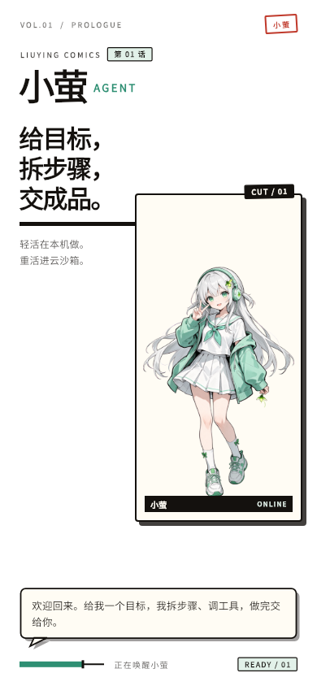
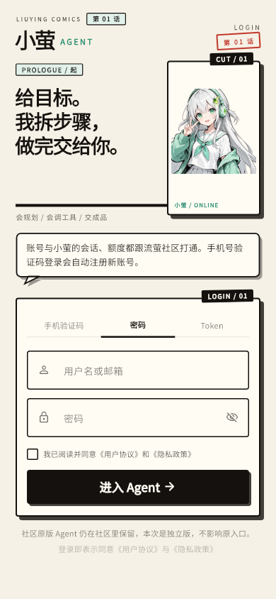
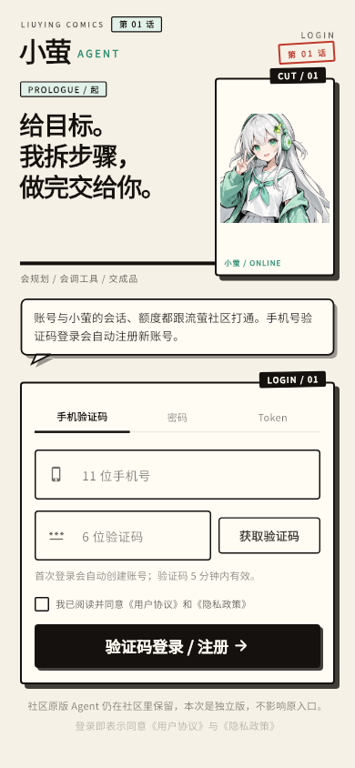
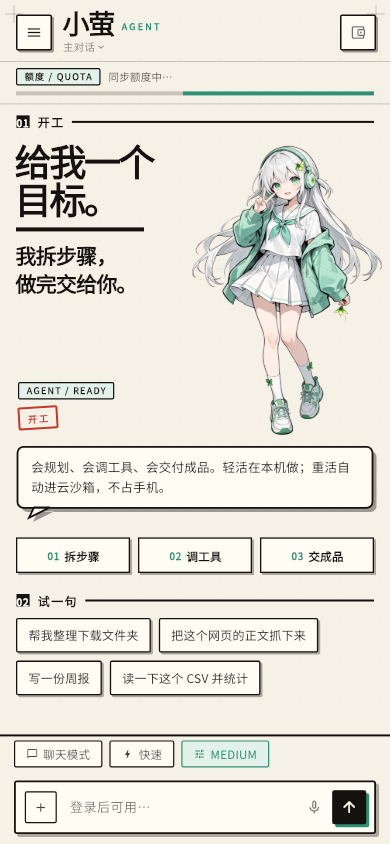
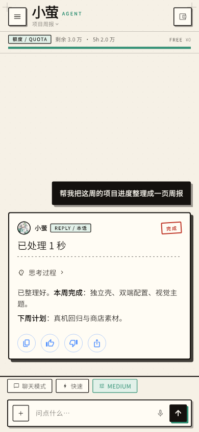
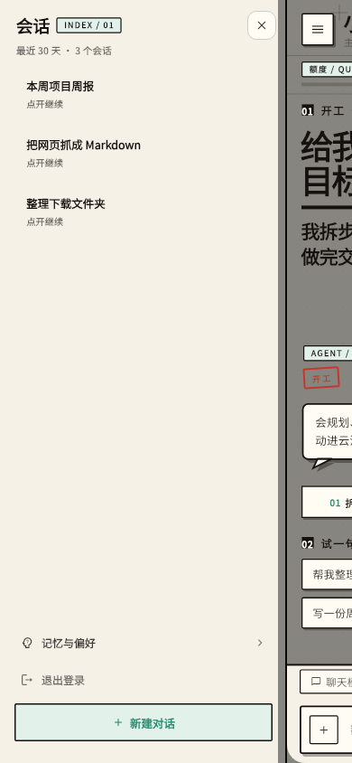

# 小萤 Agent · 独立 App

> 日系漫画风格的独立 AI Agent 客户端。原生 Flutter（Android + iOS），复用流萤社区 `/af` 后端，账号、会话与额度与流萤社区互通。








## 这是什么

这是从「流萤社区」中剥离出来的 **Agent 前端独立壳**：

- **社区原版 Agent 不删除、不改造**，继续留在社区 App 内。
- 本仓库只复制 Agent 页面及其依赖闭包，补独立启动页、登录页、退出登录与双端工程配置。
- 共用社区 `/community/api/af/*` 接口，不新造后端。
- 登录继续走流萤音乐/社区账号体系，Token 与额度互通。
- 原生 Flutter 实现，不是 WebView 套壳。

## 功能

- 纸白漫画启动页 + 手机号验证码（默认）/ 账号密码 / Token 三种登录方式
- 会话列表、新建/删除会话、历史消息
- SSE 流式对话、思考过程折叠、工具调用卡片
- 多模式（对话 / 快速 / 工作）与模型选择
- 文件与图片附件、语音输入、文件下载、消息复制/分享
- 额度与余额展示、兑换码入口
- 退出登录清理安全存储并回到登录页
- 日系漫画视觉：网点/速度线背景、硬边框分镜、对话框、贴纸与手绘加载条

## 目录结构

```text
lib/
  main.dart                 独立启动壳、启动页 → 登录门 → Agent
  splash_page.dart          1450ms 品牌启动页
  login_page.dart           手机验证码 / 密码 / Token 登录
  config.dart               站点、API、媒体地址
  api/client.dart           HTTP / Token / 登录
  design/
    tokens.dart             墨黑 + 薄荷 + 暖纸白主题、字体
    manga.dart              网点背景、分镜框、贴纸、对话框、加载条
    components.dart         通用组件
  pages/home/
    af_workbench_page.dart  复制自社区 Agent 工作台，新增 onLogout
    af_palette.dart         Agent 专用色板
assets/
  ai/                       小萤头像与招手 GIF
  brand/                    透明小萤立绘与头肩贴纸
  fonts/                    NotoSansSC
android/                    com.liuying.agent，独立签名与启动屏
ios/                        com.liuying.agent，权限、启动屏与图标
test/                       widget / 布局 / 视觉 golden 测试
tool/                       素材与构建辅助脚本
docs/                       验收说明与截图
```

## 后端接口

生产默认：

```text
站点     https://www.dbmt999.asia
API      https://www.dbmt999.asia/community/api
音乐登录 https://www.dbmt999.asia/music/api/login
```

可用 `--dart-define` 覆盖：

```bash
flutter run \
  --dart-define=SITE_BASE=https://www.dbmt999.asia \
  --dart-define=API_BASE=https://www.dbmt999.asia/community/api
```

主要接口：`/af/quota`、`/af/conversations`、`/af/messages`、`/af/chat`（SSE）、`/af/models`、`/af/files`、`/af/redeem`。

## 本地运行

```bash
flutter pub get
flutter run
```

要求 Flutter stable（本工程在 3.47.7 上验证），Dart SDK `^3.13.5`。

## 构建

### Android

签名文件与密码不入库。复制模板并填入自己的签名：

```bash
cp android/key.properties.example android/key.properties
# 编辑 key.properties；将 .jks 放到 android/app/
flutter build apk --release
```

产物：`build/app/outputs/flutter-apk/app-release.apk`

包名 `com.liuying.agent`，`minSdk 24`，`targetSdk 36`。

### iOS（未签名）

```bash
flutter build ios --release --no-codesign
mkdir -p Payload
cp -R build/ios/iphoneos/Runner.app Payload/
zip -qry LiuyingAgent-1.0.1-unsigned.ipa Payload
```

仓库自带 GitHub Actions：`.github/workflows/ios-unsigned.yml`。推送 tag 或在 Actions 里手动运行，会构建未签名 IPA 并上传到 GitHub Release。未签名 IPA 需要 AltStore / Sideloadly / 自签工具安装，不能直接上架 App Store。

## 验证

```bash
flutter analyze
flutter test
flutter test test/visual_test.dart --update-goldens
```

当前结果：`flutter analyze` 0 issues，`flutter test` 全部通过；视觉基线为 390×844（启动/登录/手机验证码登录/欢迎/对话/会话抽屉/推理档位），另有 320×568 小屏与 1.3 倍字体布局测试。CI 用 `--exclude-tags golden` 规避 macOS 与 Linux 的字体栅格差异。

详见 [docs/VERIFY.md](docs/VERIFY.md)。

## 安全

- Token 存在 `flutter_secure_storage`，不写明文 SharedPreferences。
- Android `allowBackup=false`、`usesCleartextTraffic=false`；iOS ATS 禁止任意明文。
- 仓库不包含 `android/key.properties`、`*.jks`、构建产物与签名私钥；设计母版在 `brand_src/`。
- 附件与下载链接走社区同源接口；不新增第三方统计 SDK。

## 品牌素材

角色「小萤」原图由项目方提供。启动主视觉、App 图标、透明立绘与头肩贴纸基于该形象生成；设计母版在 `brand_src/`，App 内使用透明 PNG。视觉方向为日系漫画：银发绿瞳、薄荷绿、墨黑、暖纸白、网点、裁切标记与硬边框分镜。

## 与社区的关系

- 社区仓库：`13048773046/liuying-community-source`
- 本仓库：`13048773046/liuying-agent-app`
- 社区原版 Agent 未改动；本仓库是独立分发壳，共用同一套 `/af` 后端与账号体系。

## 许可

角色形象、品牌名与素材归项目方所有。代码仅用于本项目分发，未声明开源许可前默认保留所有权利。
